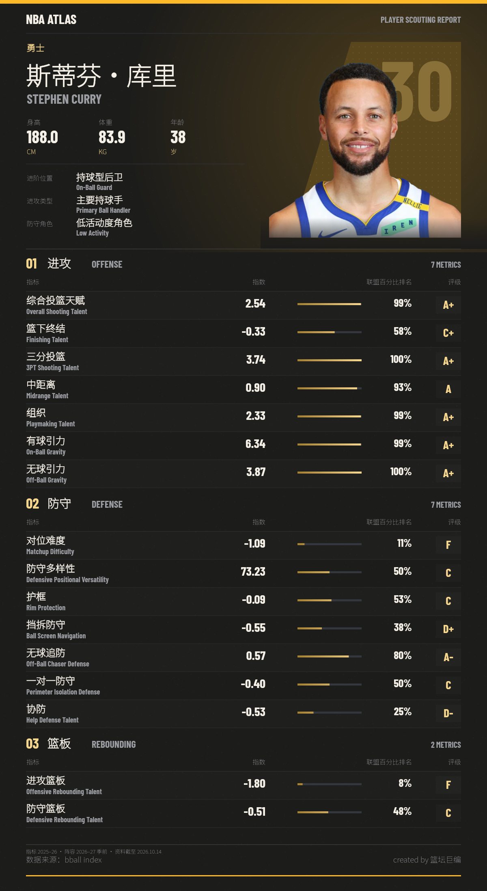

# nba-player-skill · NBA 球员技能卡

输入中文名、英文名或常见绰号，生成一张可保存的NBA ATLAS技能卡。进攻、防守、篮板16项指标合在同一张PNG中，保留网站的球队配色、人物头像、指数、联盟百分比排名和评级。

## 安装到支持 Skills 的智能体

把本仓库完整下载到技能目录，文件夹命名为 `nba-player-skill`。例如Codex放入 `~/.codex/skills/nba-player-skill`，Claude Code放入 `~/.claude/skills/nba-player-skill`，随后重新加载智能体。

也可以告诉智能体：

> 从 https://github.com/jesusguy115-crypto/nba-player-skill 安装这个 skill。

安装后输入：

> 使用 nba-player-skill，生成萌神的球员技能卡。

也支持“斯蒂芬·库里”“Stephen Curry”“KD”“字母哥”“SGA”等。含糊的姓氏会给出候选，未收录的球员不会捏造数据。

## 独立运行

需要Python 3.9+、Node.js 20+、npm。首次安装依赖需要网络，之后生成可离线运行。

```bash
python3 bootstrap.py
npm install --omit=dev
node generate.mjs --player '库里' --output './outputs/curry.png'
```

`--lookup` 只查询姓名；`--player-id ID` 选择明确球员；`--overwrite` 明确覆盖输出。渲染结果1200×2190，默认写入当前工作目录的 `outputs/`。所有执行源代码均为仓库根目录的 `.mjs` 和 `.py`，资源使用ZIP打包减少文件数量，bootstrap会校验SHA256再解压。

## 固定快照

2026–27季前阵容、2025–26技能数据，资料核对截至2026-10-14。包含622名球员、481份技能报告、601张头像。缺失项显示“—”，无报告者只生成资料卡。球队和年龄同样属于快照，不是实时资料。数据定义及第三方素材说明见 [SOURCE-NOTICE.md](SOURCE-NOTICE.md)。

Created by 篮坛巨编。

## 图片示例



程序代码与指令按MIT许可提供；第三方数据、头像及字体适用各自的权利与许可，见来源说明。
